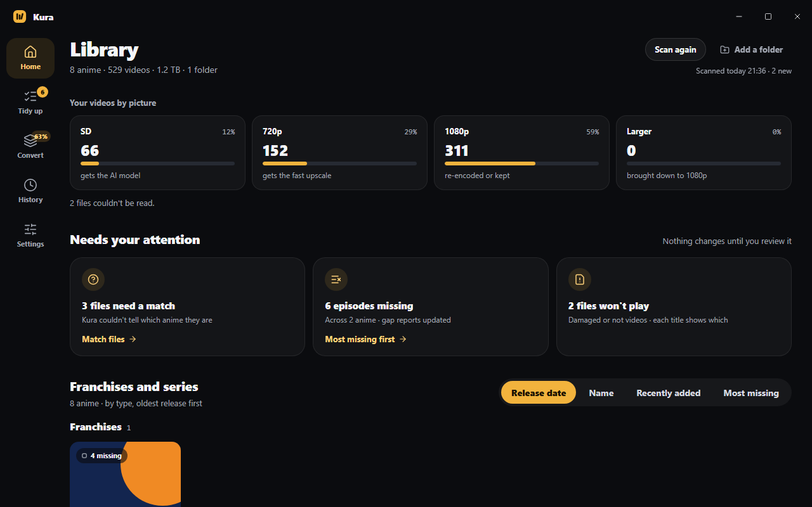
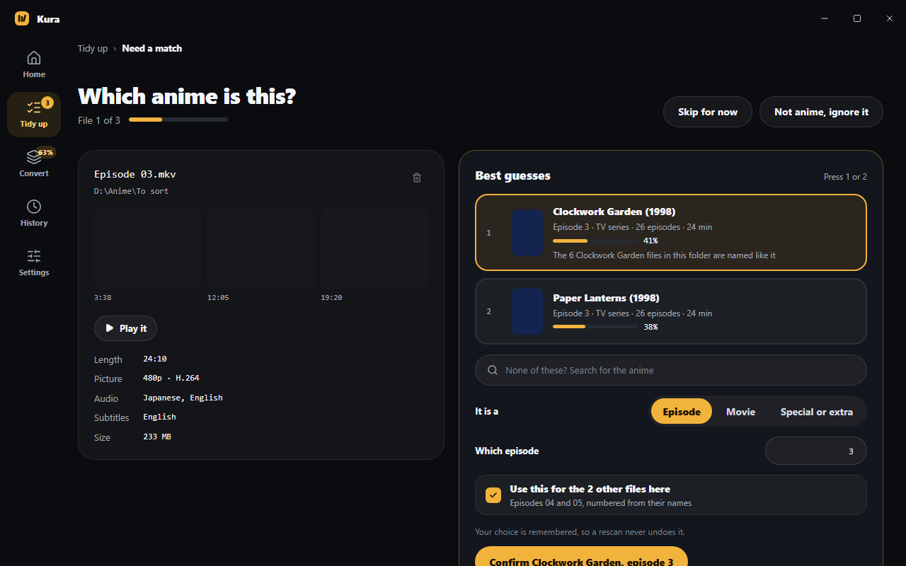
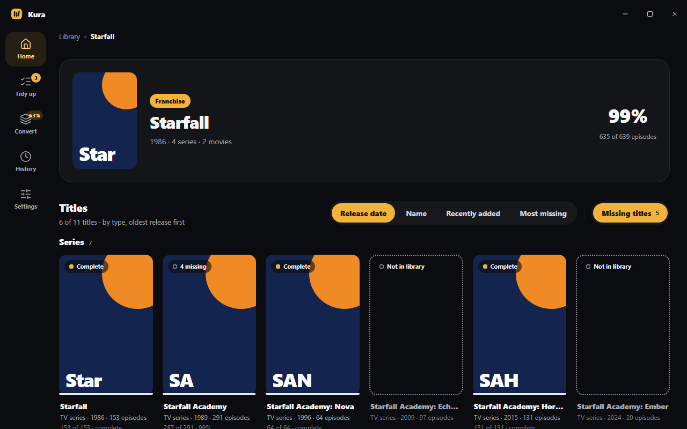
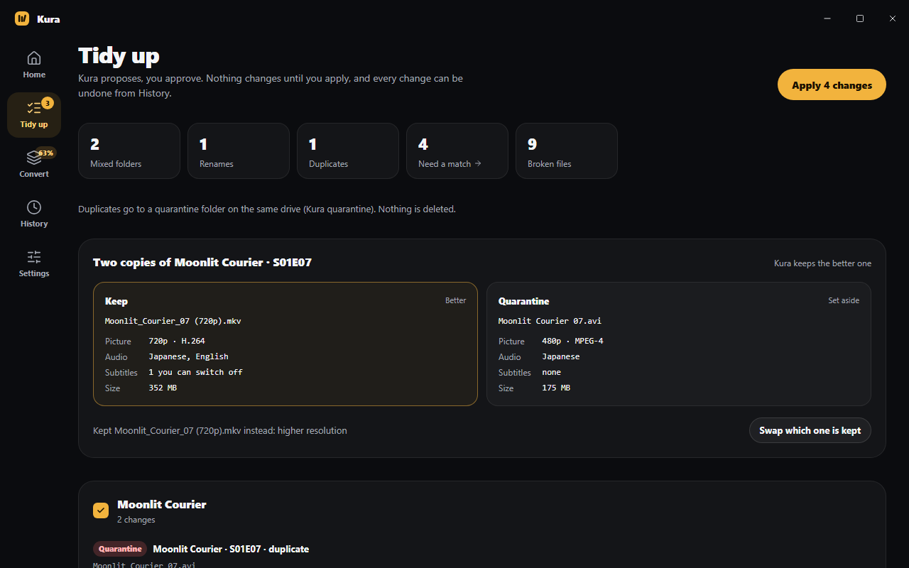
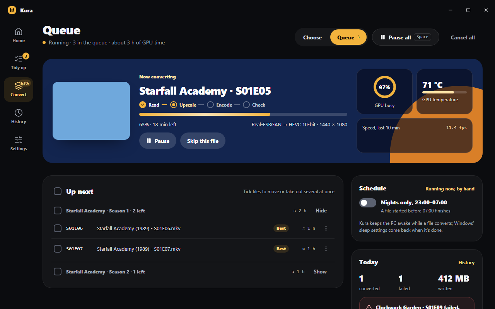
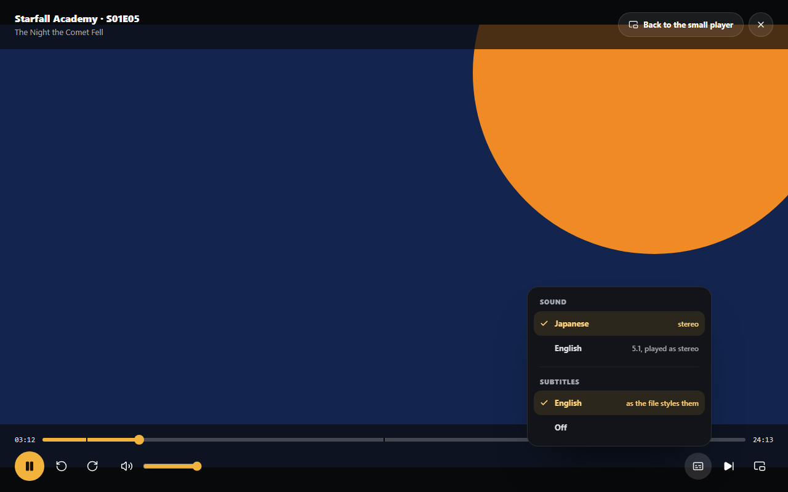

# Kura

**蔵, "storehouse". A home for your anime library, on your PC.**

Kura reads folders in any layout, recognises every episode, film and OVA, tells you what's
missing, files it all under clean names and converts it to one standard, AI upscaling included.
Then you can watch it, right in the app. Every change waits for your yes, and can be undone.
It's for the videos you already have: Kura never finds, downloads or shares anime.

[**Download for Windows**](https://frankgrobbelaar.github.io/kura/) · free and open source · no account

## A tour in five steps

### 1. Point it at your folders

One anime per folder, a franchise in sub-folders, or everything mixed together: Kura reads every
video (length, picture, sound, subtitles) and finds each one on AniList and TMDB. What it isn't
sure of waits on "Which anime is this?", with stills and a quick look at the file itself.

### 2. See what's missing

Every title gets a page: its seasons, an episode map, the episodes that aired that you don't
have, and a gap analysis beside the files. A franchise's page shows even the films and OVAs you
have none of, in their places, and keeps watching for new ones.

### 3. Tidy up

Clean names and folders, `TV\Show (Year)\Season 01\…` and `Movies\Title (Year)\…`, with
subtitles moving alongside. Kura proposes, title by title; nothing moves until you apply it, and
History undoes anything.

### 4. Convert to one standard

1080p or 720p, HEVC 10-bit on your graphics card. SD gets an AI upscale, 720p Anime4K, and "See
it first" shows a frame before and after. The queue can run only at night, waits when a drive
is full, and checks every result before it replaces the original.

### 5. Watch it

Press Play on any episode. A small player floats over the page wherever you drag it, and goes
full screen and back, with the sound and subtitles the file has and the next episode a click
away.

## Safe by design

| | |
| --- | --- |
| **Asks first** | Renames, moves, deletions and conversions are proposed, then applied on your word. |
| **Undoes** | History puts back any tidy-up, and any converted file's original. |
| **Keeps copies** | What's replaced or deleted waits 30 days in quarantine on its own drive. |
| **Stays local** | No account and no cloud; nightly backups and a one-zip export. |

## Your own videos only

Kura looks after video files that are already on your PC, and plays them only in its own window.
It never searches for, downloads or shares anime or any other video, never streams it over the
internet, and doesn't get around copy protection. Use it only with videos you have the right to
keep and watch: Kura is not for piracy, in any form.

Kura contains no anime, artwork or other media. The titles in these pictures are made up, the
posters are Kura's own placeholders and the video playing is a stand-in; where Kura's code and
notes name a real series, it's only as example data. AniList and TMDB, where Kura looks titles
up, are their owners' trademarks, and Kura isn't affiliated with or endorsed by either. This
product uses the TMDB API but is not endorsed or certified by TMDB.

## Download

From the [downloads page](https://frankgrobbelaar.github.io/kura/): Windows 10 or 11, 64-bit,
every version with what changed. Kura updates itself. It isn't code-signed, so SmartScreen warns
the first time: More info › Run anyway. The installer's first page lists everything Kura
downloads, such as ffmpeg on the first run.

## Licence

Free software under the [MIT licence](LICENSE), with no warranty; what it's built on is listed,
each part with its licence, in `THIRD-PARTY-NOTICES.txt` with every release. Fork it freely; this
repository doesn't take contributions.
