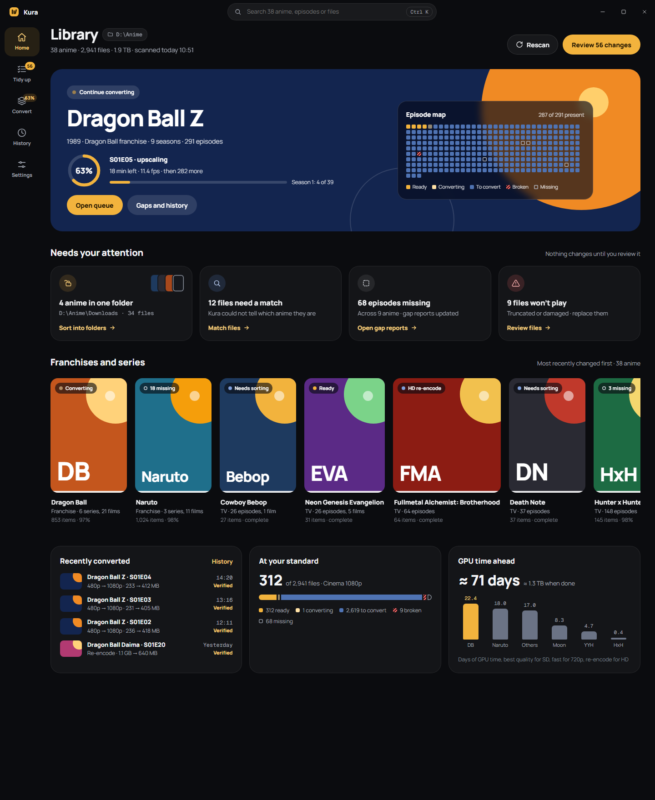

# Kura

Kura (蔵, "storehouse") is a private Windows app for one anime library. It maps folders in any
layout, identifies every file, reports what is missing or broken, renames for Plex, and converts
the whole library to one standard, with AI upscaling for SD sources. Nothing changes until you
review it, and everything stays on your PC: no accounts, no cloud.



## Start here

- [CLAUDE.md](CLAUDE.md): the decisions so far and the ground rules.
- [AGENTS.md](AGENTS.md): how coding agents work here, with a guide in each area.
- [docs/](docs/README.md): architecture, development, conventions, design, releasing, and a page
  for every tool in the stack.
- [docs/design/](docs/design/README.md): every screen, as pages you can open.

## Run it

Set up the tools in [docs/development.md](docs/development.md) (Rust, Node LTS, pnpm, uv), then:

```powershell
cd engine; uv sync
cd ../app; pnpm install; pnpm tauri dev
```

## What's where

| Folder | Holds |
| --- | --- |
| `app/` | The desktop app: React UI in `src/`, Tauri shell in `src-tauri/` |
| `engine/` | The Python engine: local API, command line, database |
| `docs/` | How it works, how to work on it, and the designs |
| `scripts/` | Setting the version, refreshing the design snapshot |
| `.github/` | CI and the release workflow |
