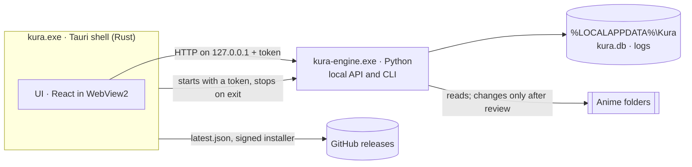

# Architecture

Kura is three programs that work as one: a thin **shell** that owns the window, a **UI** inside it,
and an **engine** that does the real work. Everything runs on this PC; the only network traffic is
looking up titles and artwork (later) and checking for updates.



| Part | Where | Does |
| --- | --- | --- |
| Shell | `app/src-tauri` | The window and its title bar, one instance at a time, the engine's lifetime, updates |
| UI | `app/src` | Every screen. Reads and changes things only through the engine's API |
| Engine | `engine/src/kura` | Scanning, identifying, planning, converting, reports, export, the database |

The shell stays small on purpose: logic that isn't about the window or the process belongs in the
engine, where it is easy to test.

## Start, run, stop

1. The shell starts `kura serve --watch-stdin` with a fresh random token in `KURA_TOKEN`
   (in development: `uv run kura …` from `engine/`; installed: the bundled `kura-engine.exe`).
2. The engine listens on `127.0.0.1` on a free port and prints one line:
   `{"event": "ready", "port": 51234}`.
3. The shell sends the UI an `engine-status` event with the address and token.
4. The UI calls the API with `Authorization: Bearer <token>`.
5. On exit the shell closes the engine's stdin and the engine shuts down (the shell ends it
   after 3 seconds if it hasn't). If Kura crashes, Windows closes the pipe anyway, so the engine
   never outlives the window. The engine puts itself in a Windows job that ends every program it
   starts (ffmpeg) when it ends, however it ends.

If no ready line arrives within a minute, the engine exits first, or it stops on its own later,
the status becomes `failed` with the engine's last error lines, and the UI says so with "Try again"
and "Copy details". Both sides of this handshake are tested: `engine/tests/test_cli.py` and
`app/src-tauri/src/engine.rs`.

## Contracts

| Between | How | Kept honest by |
| --- | --- | --- |
| Shell and engine | `serve` arguments, `KURA_TOKEN`, the ready line, stdin | Tests on both sides |
| Shell and UI | Commands `engine_status`, `restart_engine`, `prepare_update`, `install_update`; event `engine-status` | Types mirrored in `app/src/lib/engine.tsx` and `updates.ts` |
| UI and engine | JSON over HTTP, camelCase | `engine/openapi.json` snapshot + test; types in `app/src/lib/engine.tsx` |

Change a contract on both sides in the same commit.

## Inside the engine

```
kura/
  cli.py          commands: serve, export, openapi, version
  api/            the FastAPI app; one router module per feature
  core/           library logic as pure functions: no files, network or database
  config.py       where the data folder is
  db.py           connecting to SQLite and migrating it
  migrations.py   the schema, as an append-only list
  library.py      library folders, and finding and reading their videos
  scan.py         the scan: find every video, read each one, identify it, check the library
  identify.py     which anime and episode each video is, asked of AniList and TMDB
  cache.py        their answers, kept a while so a rescan asks nobody again
  titles.py       the library's titles with their gaps, sorted by release date or otherwise
  reports.py      the gap analysis written next to each anime with a folder of its own
  artwork.py      posters, fetched once from TMDB or AniList and kept
  watch.py        keeping the library current while Kura is open: watching, refreshing
  probe.py        running ffprobe on one file
  tools.py        downloading what downloads.json lists (ffmpeg)
  tidy.py         tidying up: the plan that files the library for Plex, applied and undone
  changes.py      applying and undoing plans (tidy-ups, a converted file's replacement), journaled
  convert.py      converting one file, checked, then in its original's place
  upscale.py      the AI model on the graphics card, between two ffmpegs
  queue.py        the conversion queue: files in the owner's order, converted one at a time
  preview.py      See it first: one frame before converting and after
  gpu.py          how busy and how warm the graphics card is (nvidia-smi)
  history.py      what Kura did, newest first: tidy-ups, conversions and scans
  web.py          asking web services for JSON: timeouts, rate limits, errors in words
  anilist.py      AniList: which anime a file is
  tmdb.py         TMDB: episode lists, titles and artwork, with the owner's key
  credentials.py  the TMDB key, encrypted for the Windows user, outside the database
  system.py       the graphics card, and ending the programs the engine starts with it
  export.py       the export zip
  data.py         how big each part of the data folder and each drive's quarantine is
  backups.py      the nightly backups of the database, and restoring one as the engine starts
  quarantine.py   clearing out what has waited in quarantine longer than the owner keeps it
  care.py         looking after Kura while it's open: tonight's backup, the daily clear-out
```

The core is the heart and stays pure: it takes plain values (file facts, titles, settings) and
returns plain values (matches, plans, estimates). The code around it reads files, calls services
and writes the database, then hands the core what it needs. That way every rule about anime is a
fast, simple test.

The pipeline the core will grow into, step by step:

| Step | Takes | Gives |
| --- | --- | --- |
| Parse | file names and folders | title, season, episode, group, quality |
| Match | parsed names, AniList and TMDB | which anime and episode, with a confidence |
| Plan | matches, the standard, the naming style | proposed renames, moves, quarantines, conversions |
| Check | the library, finished conversions | gaps, broken files, verified outputs |
| Estimate | a plan, measured speeds | GPU time and disk space |

Scanning (`kura/scan.py`) runs on a background thread: it walks each library folder for videos
(`kura/library.py`, by the rules in `kura/core/library.py`) and records each with its size and
time, then reads the new and changed ones with ffprobe (`kura/probe.py`). Everything is saved as it
goes and the scan's stage is in the `scans` table, so a pause, an exit or a crash loses nothing: the
next start carries on. Then each video read is identified (`kura/identify.py`): files that look
like the same anime are looked up together on AniList, and with the owner's TMDB key the same show
or film is found on TMDB, whose episode lists say where each file sits. An OVA or special goes
into its show's season 0 when the library has the show and TMDB lists it among the show's
specials on the day it first aired; otherwise it's a title of its own. Titles AniList ties
together by story (sequels, prequels, alternative versions, films, side stories) make a franchise
(`kura/core/franchise.py`): Home shows each franchise as one card with a page of its own (an entry
matched before Kura kept these links is asked about at the next scan). A file
Kura isn't sure about waits for the owner, whose choice is pinned (an episode Kura can't place
asks for its number); offline, identification waits for the next scan and the scan says so. A
title's match can be changed for all its files at once (`Identifier.rematch`), chosen for its
first episode: files of that kind take the owner's choice, the others keep theirs (a series'
specials stay specials), and any that doesn't fit the new anime waits for the owner.
Last, the scan checks the library: each series with a folder of its own gets its
`Kura - Gap analysis.md` (`kura/reports.py`), rewritten only when its news changes. The missing
episodes are the ones TMDB lists as aired that no file holds (`kura/core/gaps.py`), or without a
TMDB key the ones AniList counts as aired so far; specials and OVAs are listed apart and never
counted as missing.

While Kura is open, `kura/watch.py` keeps the library current: a scan at start catches up on what
changed while Kura was closed; the library folders are watched (`watchdog`), so a new, removed or
renamed video starts a scan once its folder is quiet; and episode lists are asked for again on
schedule, hourly for shows still airing and weekly for finished ones.
A folder on an unplugged drive is skipped and its files stay as they were,
and so do the files in a folder the walk couldn't open; only a file whose folder is there without
it is marked gone. Links and junctions aren't followed. Files that couldn't be read are read again
by the next scan. If ffprobe itself doesn't work, the scan stops without marking any file and
ffmpeg is offered for download again. Scans only look; nothing in the folders changes.

Tidying up (`kura/tidy.py`) proposes where every identified video goes: Plex's layout under
its own library folder (`kura/core/plan.py` and `kura/core/naming.py`), each title's changes
together, with copies of one episode compared and all but the best set aside in a "Kura
quarantine" folder on the same drive. Copies are files of one title's same episode (a file
holding two episodes isn't a copy of one) or of one film; a film in parts (CD1, CD2) is filed as
its parts (`- pt1`, `- pt2`, as Plex stacks them). A video stays where it is, with the reason,
when its new name would be too long for Windows (its subtitles' included) or its new folder is
one scans skip (a link, or a name starting with a dot). A folder on the way that's there already
keeps its own spelling ("cowboy bebop (1998)"), so the records name files exactly as the disk
does. The owner keeps the titles they want, and
may keep the other copy instead.

A plan is applied only after review, exactly as reviewed: the app sends back each change it
showed (source, kind and target), and if Kura proposes any of them differently now (a scan or a
new match changed it), nothing moves and the owner looks again. `kura/changes.py` writes each
change to the database before and after its file moves, so it can be undone (newest first) and
so the engine, when it starts, can settle any move a crash interrupted. A plan counts as applied
from its first move, so History has it even after a crash, and the moves Kura hadn't reached
are closed at the next start (tidying up proposes them again). A change and its video's record
are saved together. Nothing is overwritten: a taken name fails that change, and the rest go
ahead. A move to another drive copies, checks the copy, and
only then removes the original. Subtitle files named after a video (`Episode 1.en.srt`) move and
rename with it, and folders inside a library folder that the moves leave truly empty are removed
(undo makes them again as it moves the files back). A video's record moves with it, so it keeps
what it was identified as (a quarantined one counts as gone until it's put back); a gap analysis
left in a folder that no longer holds a video goes with the folder, and the reports are written
again where the shows are. Nothing moves while a scan runs, and no scan starts while files move
(`Scanner.hold`); what Windows tells of Kura's own moves starts no scan, since the records
follow them already. History lists every tidy-up,
which can be undone from there, and undone again for any file that couldn't go back the first
time (the plan counts as undone only once nothing is left).

Deleting (`tidy.delete`, from a title's page: the whole title, a season or one video) is a plan of
the same kind: each video and the subtitles named after it go to the quarantine on their own
drive, folders left empty go, a video waiting to be converted leaves the queue (one converting
can't be deleted), and History, or the page right after, puts them back until the quarantine is
cleared out. Kura never deletes a file outright.

Converting (`kura/convert.py`) brings one file to the standard by the method its recipe names
(`kura/core/convert.py`): the AI model between two ffmpegs (`kura/upscale.py`), or one ffmpeg
command (see [stack/upscaling.md](stack/upscaling.md)). The result is made beside the original,
checked (length, streams, Kura's tag, a test play at three points), and only then takes the
original's place, journaled like a tidy-up, the original going to quarantine; no scan runs
meanwhile. The queue (`kura/queue.py`) holds the files waiting, in the owner's order, and its
worker converts them one at a time while Kura is open; on the nights-only schedule it starts
files only between 23:00 and 07:00. Pausing or skipping stops ffmpeg at once and leaves the
original as it was (a paused file starts over); a result made already is still checked and put in
place when the queue pauses, and thrown away when it's skipped. A file whose result would take a
name that's taken fails before anything is made, and Windows doesn't sleep while a file converts.
After a crash, a file that was converting waits in line again, and one whose result was taking
its original's place is finished, or its original put back. A file being converted, and any
copy of it, stays out of tidy-ups. History lists each conversion with what it made, and puts the original back on asking.
Before queueing, the Convert screen shows one frame of a file before and after
(`kura/preview.py`), made the way the conversion would make it, and kept as PNG in the cache.

## Data

- **The data folder**, `%LOCALAPPDATA%\Kura`: `kura.db` (everything Kura knows), `logs/`
  (`engine.log`, kept 30 days), `tools/` (ffmpeg), `credentials.json` (the TMDB key, encrypted by
  Windows for this user and never exported), `cache/` (answers from TMDB and AniList, safe to
  delete), `artwork/` (posters), `backups/` (the last 7 nights, each checked as it's made).
  `kura/care.py` makes tonight's backup from 03:00 (or the first chance after) and clears out of
  the quarantine, once a day, what has waited longer than the owner keeps it. A backup chosen in
  Settings is restored as the engine starts again, before anything opens the database, and what
  Kura knew till then is backed up first.
  Development uses `engine/.dev-data`, so it never touches the real folder.
- **The database** is SQLite, upgraded in place by migrations (see [stack/sqlite.md](stack/sqlite.md)).
  A database written by a newer Kura is refused, not damaged.
- **With the anime**: `Kura - Gap analysis.md` per anime (the owner can turn these off in
  Settings, which takes them out of the folders), later `Kura - History.md`, a tag inside each
  converted MKV, optional Plex artwork. These survive a reinstall, and Kura can rebuild its
  library from the tags.
- **Export**: one zip, readable without Kura, written to a folder the owner picks in Settings (or
  with `kura export`). It grows with the schema.
- **Quarantine**: `Kura quarantine\<day>\` on each drive the library is on, holding copies set
  aside and converted files' originals; Settings shows its size and how long it's kept.

## Safety on a shared PC

- The engine listens only on `127.0.0.1`, on a port chosen at random.
- Every request needs the launch's token; anything else gets 401.
- Only the app's own pages may call it (CORS), and only when addressed to this PC (Host check).
- The window's content security policy allows the app itself, Tauri's IPC and the local engine.
- The window may call only the core APIs, its title bar buttons and Kura's own commands
  (`app/src-tauri/capabilities/default.json`).
- An update runs only if its signature matches the public key built into Kura.

## On an installed PC

| What | Where |
| --- | --- |
| Program | `%LOCALAPPDATA%\Programs\Kura` (`kura.exe`, `engine\`, `uninstall.exe`) |
| Data | `%LOCALAPPDATA%\Kura` |
| WebView2 cache | `%LOCALAPPDATA%\io.github.frankgrobbelaar.kura` |
| Uninstaller's export | `Documents\Kura export <date>.zip` |
