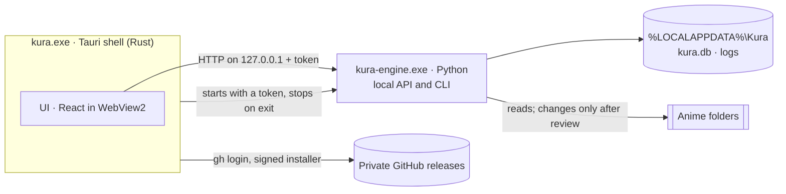

# Architecture

Kura is three programs that work as one: a thin **shell** that owns the window, a **UI** inside it,
and an **engine** that does the real work. Everything runs on this PC; the only network traffic is
looking up titles and artwork (later) and checking for updates.



| Part | Where | Does |
| --- | --- | --- |
| Shell | `app/src-tauri` | The window and its title bar, one instance at a time, the engine's lifetime, updates |
| UI | `app/src` | Every screen. Reads and changes things only through the engine's API |
| Engine | `engine/src/kura` | Scanning, identifying, planning, converting, reports, export, the database |

The shell stays small on purpose: logic that isn't about the window or the process belongs in the
engine, where it is easy to test.

## Start, run, stop

1. The shell starts `kura serve --watch-stdin` with a fresh random token in `KURA_TOKEN`
   (in development: `uv run kura …` from `engine/`; installed: the bundled `kura-engine.exe`).
2. The engine listens on `127.0.0.1` on a free port and prints one line:
   `{"event": "ready", "port": 51234}`.
3. The shell sends the UI an `engine-status` event with the address and token.
4. The UI calls the API with `Authorization: Bearer <token>`.
5. On exit the shell closes the engine's stdin and the engine shuts down. If Kura crashes, Windows
   closes the pipe anyway, so the engine never outlives the window.

If no ready line arrives within a minute, the engine exits first, or it stops on its own later,
the status becomes `failed` with the engine's last error lines, and the UI says so with "Try again"
and "Copy details". Both sides of this handshake are tested: `engine/tests/test_cli.py` and
`app/src-tauri/src/engine.rs`.

## Contracts

| Between | How | Kept honest by |
| --- | --- | --- |
| Shell and engine | `serve` arguments, `KURA_TOKEN`, the ready line, stdin | Tests on both sides |
| Shell and UI | Commands `engine_status`, `restart_engine`, `prepare_update`, `install_update`; event `engine-status` | Types mirrored in `app/src/lib/engine.tsx` and `updates.ts` |
| UI and engine | JSON over HTTP, camelCase | `engine/openapi.json` snapshot + test; types in `app/src/lib/engine.tsx` |

Change a contract on both sides in the same commit.

## Inside the engine

```
kura/
  cli.py          commands: serve, export, openapi, version
  api/            the FastAPI app; one router module per feature
  core/           library logic as pure functions: no files, network or database
  config.py       where the data folder is
  db.py           connecting to SQLite and migrating it
  migrations.py   the schema, as an append-only list
  export.py       the export zip
```

The core is the heart and stays pure: it takes plain values (file facts, titles, settings) and
returns plain values (matches, plans, estimates). The code around it reads files, calls services
and writes the database, then hands the core what it needs. That way every rule about anime is a
fast, simple test.

The pipeline the core will grow into, step by step:

| Step | Takes | Gives |
| --- | --- | --- |
| Parse | file names and folders | title, season, episode, group, quality |
| Match | parsed names, the manami database, TMDB and AniList | which anime and episode, with a confidence |
| Plan | matches, the standard, the naming style | proposed renames, moves, quarantines, conversions |
| Check | the library, finished conversions | gaps, broken files, verified outputs |
| Estimate | a plan, measured speeds | GPU time and disk space |

A plan is applied only after review, with an undo journal.

## Data

- **The data folder**, `%LOCALAPPDATA%\Kura`: `kura.db` (everything Kura knows), `logs/`
  (`engine.log`, kept 30 days), later `artwork/` and `backups/` (7 nights). Development uses
  `engine/.dev-data`, so it never touches the real folder.
- **The database** is SQLite, upgraded in place by migrations (see [stack/sqlite.md](stack/sqlite.md)).
  A database written by a newer Kura is refused, not damaged.
- **With the anime**: `Kura - Gap analysis.md` and `Kura - History.md` per anime, a tag inside each
  converted MKV, optional Plex artwork. These survive a reinstall, and Kura can rebuild its
  library from the tags.
- **Export**: one zip, readable without Kura. It grows with the schema.

## Safety on a shared PC

- The engine listens only on `127.0.0.1`, on a port chosen at random.
- Every request needs the launch's token; anything else gets 401.
- Only the app's own pages may call it (CORS), and only when addressed to this PC (Host check).
- The window's content security policy allows the app itself, Tauri's IPC and the local engine.
- The window may call only the core APIs, its title bar buttons and Kura's own commands
  (`app/src-tauri/capabilities/default.json`).
- An update runs only if its signature matches the public key built into Kura.

## On an installed PC

| What | Where |
| --- | --- |
| Program | `%LOCALAPPDATA%\Programs\Kura` (`kura.exe`, `engine\`, `uninstall.exe`) |
| Data | `%LOCALAPPDATA%\Kura` |
| WebView2 cache | `%LOCALAPPDATA%\io.github.frankgrobbelaar.kura` |
| Uninstaller's export | `Documents\Kura export <date>.zip` |
